# 🕶️ Forever Enhanced Privacy

A private mode for streams and screenshots in World of Warcraft: Forever. Turn it on and the names, chat giveaways and location details your viewers shouldn't see are swapped or hidden. Turn it off and everything comes back exactly as it was.

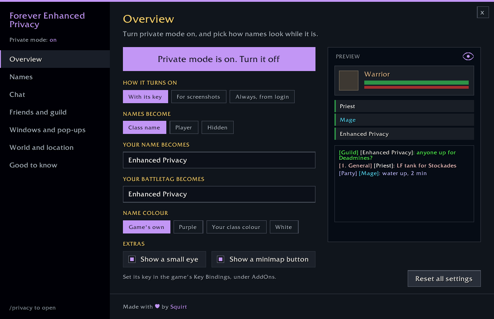

## ✦ What it covers

- 🧑 **Names everywhere:** player, target, focus, party and raid frames, nameplates, tooltips, names above heads and pets. Names become a class name ("Mage"), "Player", or nothing at all.
- ✏️ **Your own name and BattleTag:** show a name of your choosing, and a made-up BattleTag in the friends windows, in the colour you pick.
- 💬 **Chat:** names swapped in every channel, whispers kept out of chat, zone names trimmed from channel names, timestamps and chat bubbles hidden. Trade, General and Looking for Group can stay readable if you like.
- 👥 **Friends and guild:** both friends windows (the classic list and the new social window), your BattleTag and its copy button, /who, ignore and recent players, the guild roster, news and message of the day, mail and the group finder.
- 🪟 **Windows and pop-ups:** invites, duels, trades, summons and res requests, ready checks, right-click menus, loot rolls, the damage meter, linked professions and the battleground scoreboard.
- 🗺️ **Where you are:** the zone name, coordinates, big zone announcements, the clock, the world map and your gold.

## 📸 In game

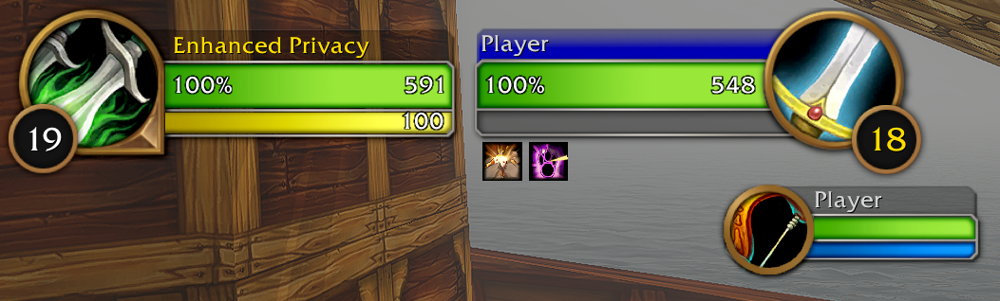
*Names become "Player"...*

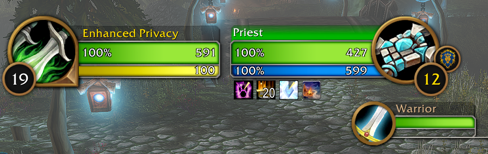
*...their class...*

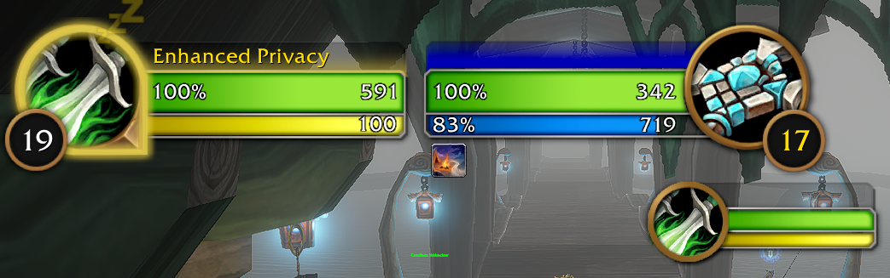
*...or nothing at all.*

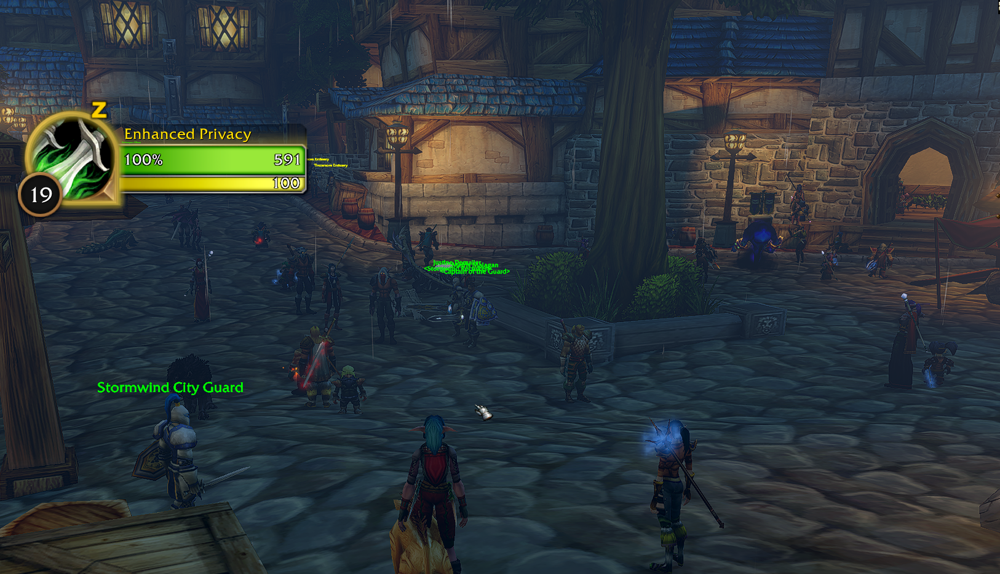
*No names above other players, even in a busy city.*

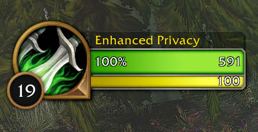 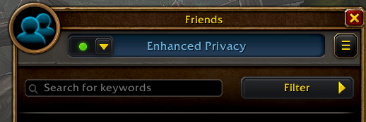

*Your own name and a made-up BattleTag.*

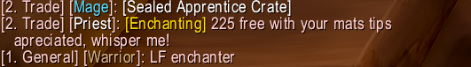 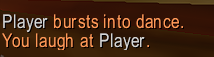

*Chat and emotes too.*

## 🔑 Turning it on

- **With its key:** set a key in the game's Key Bindings, or type `/privacy on` / `/privacy off`.
- **For screenshots:** on only while a screenshot is taken.
- **Always, from login:** on whenever you play.
- A **minimap button** toggles it with a click, and an optional small **eye** on screen shows when it's on. Neither appears in screenshots.

## 💬 Commands

- `/privacy` opens the settings
- `/privacy on`, `/privacy off`, `/privacy toggle`
- `/privacy minimap` shows or hides the minimap button

## ⚙️ Settings

Every part can be switched on or off on its own.

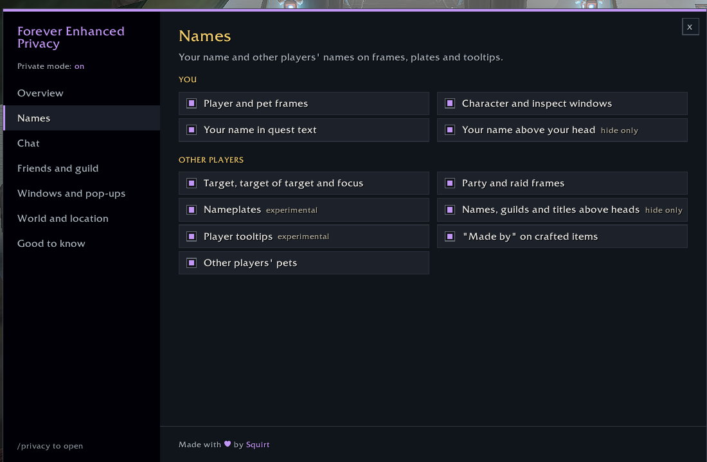 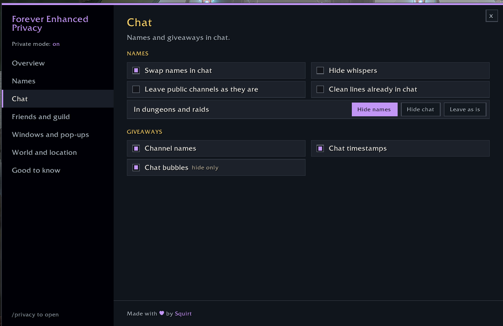
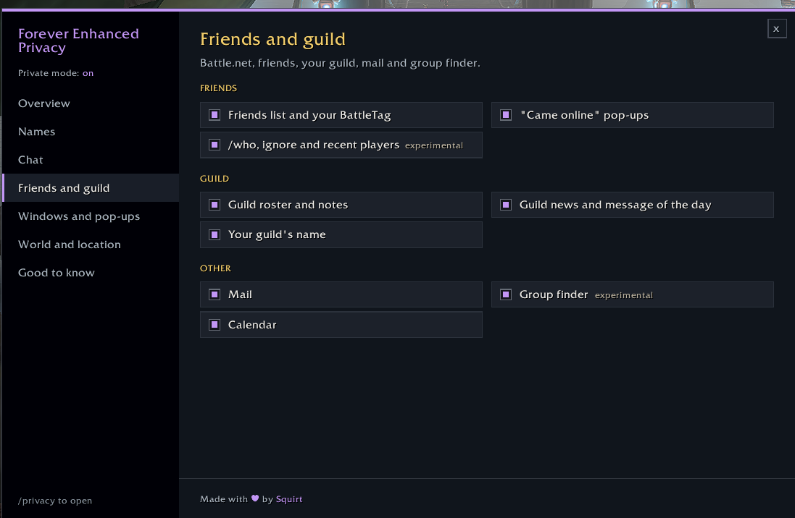 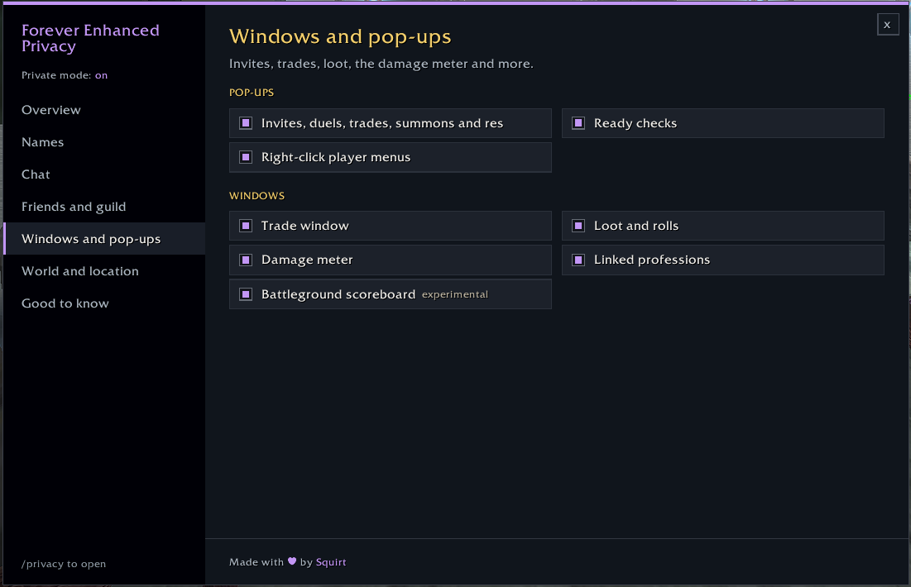
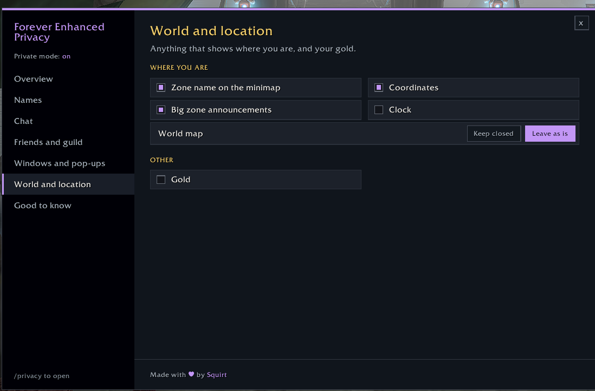 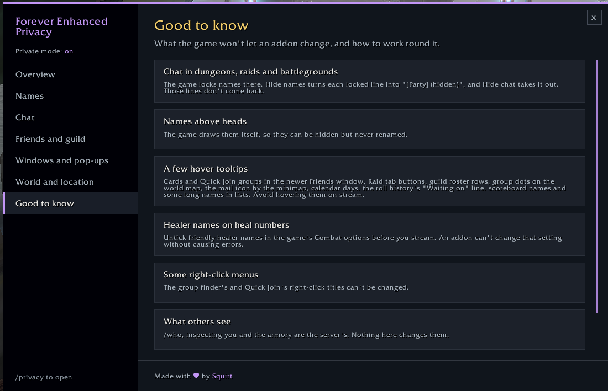

## ℹ️ Good to know

Some things the game doesn't let an addon change, such as the title of a few right-click menus and some hover boxes in the new social window. The **Good to know** page in `/privacy` lists them and how to work round them.

Settings changed while private mode is on (names above heads, chat bubbles and so on) are put back when you turn it off, log out or reload, so disabling the addon never leaves anything hidden.

---

Created by Squirt for World of Warcraft: Forever. All rights reserved.
